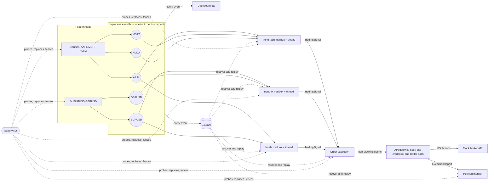

# Event-driven trading system PoC

A small C++20 trading pipeline that demonstrates genuinely parallel event processing,
bounded asynchronous messaging, topic-partitioned market data for multiple independent
strategies, and a pool of rate-limited API gateways, with a live browser dashboard. On top
of that it demonstrates **recovery and replay**: every event is journaled to disk, a
supervisor replaces workers that crash or hang and rebuilds their state from the journal,
orders survive failures exactly once, and any recorded session can be replayed and checked
against what was recorded. It uses only the C++ standard library, POSIX sockets for the
dashboard, and CMake. All prices, orders, failures and fills are simulated.

```sh
cmake -S . -B build && cmake --build build --parallel
./build/trading_demo --dashboard          # then open http://127.0.0.1:8080
```

With `--dashboard` the journal, the supervisor and two API gateways are on, and the
dashboard has buttons that crash, hang and poison workers and take a gateway down, so you
can watch the system recover. Press **Watch a replay** to replay the session so far.
After a run, `./build/trading_demo --replay journal/<session>` replays it in a new process.

## What the system does



- **Feeds** are threads that publish one quote per instrument per round, each instrument
  on its own **topic**.
- **Strategies** are independent signal processors. Each owns a thread, a bounded
  mailbox, and a strategy object (`threshold` or `ema-cross`), and subscribes only to the
  topics it trades. Subscriptions may overlap: `levels` shares AAPL with `trend-tech` and
  EURUSD with `trend-fx`, and each still gets its own copy of every quote.
- **Order execution** turns signals from every strategy into orders on the **shared API
  gateway**. All requests share one token, so they all pass one limiter.
- **Position monitor** applies execution reports per strategy and symbol.
- **Dashboard tap** is an ordinary subscriber to every event type. It shows that adding
  an observer needs no change to any other component.
- **Journal** is another ordinary subscriber: it appends every event to a durable log
  that recovery and replay read back ([Journal](#journal)).
- **Supervisor** is one thread that probes every worker and replaces the ones that fail
  ([Resilience](#resilience-and-recovery)).

The default topology is defined in `SystemConfig::demo()`. It can be replaced from the
command line (see [Configuration](#configuration)).

## Live dashboard

`./build/trading_demo --dashboard` serves a single page at `http://127.0.0.1:8080`
(`--port` changes it). The page streams a JSON snapshot every 200 ms over Server-Sent
Events and shows:

- **Pipeline diagram.** It is built from the bus's live subscription table. Moving dots
  show quote traffic per topic, and individual signals and fills travel as dots in their
  strategy's colour. Every mailbox shows its depth, turning amber when filling and red
  when shedding. Workers also show utilisation.
- **Price small multiples.** The last 20 s per instrument, with ▲/▼ markers for the
  signals each strategy published.
- **Shared API gateway.** Sliding-window usage, waiting and in-flight requests, retries,
  HTTP 429 pauses, and a queue-depth chart.
- **Latency by stage.** p50, p99 and max for the last interval plus the cumulative p99,
  with trends. Stages run from bus to handler per worker, through gateway queueing,
  rate-limit wait and broker round trip, to market data → position.
- **Tape and positions.** P&L is marked to the last price.

The controls act on the running process. You can:
- change the feed rate or pause a feed;
- add simulated per-event work to one strategy;
- raise the broker's latency;
- inject HTTP 429 responses.

Slowing one strategy to 2 ms per event is the clearest demonstration of the design. Its
mailbox fills and sheds stale quotes (about 1.4k/s here), and its dispatch latency grows
to about 570 ms. The two strategies reading the same topics stay at an empty mailbox
with a dispatch p99 of about 20 µs.

The server binds to loopback only. It rejects requests whose `Host` or `Origin` is not
loopback, as protection against DNS rebinding and cross-site use of the controls. It
never sees credentials. Every table has a table-view twin, and colours follow a
palette validated for colour-vision deficiency in light and dark themes.

## Resilience and recovery

The goal is bounded, measured recovery, not a claim of zero downtime: a failed component
is detected within a configurable time, replaced without waiting for it, and its state is
rebuilt before it takes traffic again. The order path is **exactly once**: through every
failure below, signals, orders, broker calls and fills stay equal, and nothing is sent
twice.

**What can fail, how it is noticed, what happens**

| Failure | Detected by | Recovery |
|---|---|---|
| A handler throws | caught per event (unchanged) | the event is skipped and counted |
| A worker thread dies | the thread's top-level catch marks it crashed | replaced; state rebuilt from the journal |
| A worker hangs (deadlock, endless loop) | work is waiting and nothing completes for `stall_timeout` | the thread is abandoned, not joined; a replacement takes over |
| Every event throws (poison) | consecutive handler failures reach a threshold | replaced; the poison event is dead-lettered |
| A feed thread dies | the feed marks itself crashed | a replacement resumes the sequence numbers and prices |
| An API gateway fails | per-gateway circuit breaker | requests move to another gateway with the same idempotency key |
| A component keeps failing | more than 3 restarts in 10 s | quarantined: left down, loudly, while the rest keeps running |
| Too many abandoned threads are still stuck | zombie count | the process exits non-zero for an external restarter |

A segfault or the machine dying is **not** covered: threads share an address space, so
recovering from that needs another process. See [Not done](#not-done-and-known-limits).

**Hung is not idle.** An empty mailbox is idle and never trips anything. A worker is
stalled only if its mailbox holds work and its processed count has not moved. A handler
that merely runs long is flagged `degraded`, a warning, not a restart: a slow handler
still makes progress, and restarting it would only add load.

**C++ cannot kill a thread.** A stuck worker is therefore *abandoned*: unsubscribed from
the bus, its mailbox closed, its thread left running, and the object it runs on kept alive
in a graveyard until the thread finishes by itself. A zombie that never finishes is
leaked at exit rather than waited for. It is also **fenced**: every write a component
makes (publishing a signal, submitting an order) goes through a `GenerationGate` that
checks the generation and performs the write under one shared lock, and `advance()` takes
that lock exclusively. A flag checked before writing would not be safe, because a thread
can pause between the check and the write. Once `advance()` returns, the stale instance is
not inside a write and cannot start one. When a hung thread wakes up later it finds it
cannot publish; the dashboard counts those blocked writes.

**State is rebuilt from the journal, silently.** A replacement subscribes first, so live
events buffer, then replays the journal into its strategy before it goes live. Signals
during that replay are discarded: they were either already published or are too old to
trade on, which matches the system's "act on the freshest quotes" policy. The overlap
between the journal and the mailbox is skipped by per-symbol sequence number. Mailboxes
are treated as disposable caches of the journal; a dead worker's mailbox is never rescued.

**The order path asks before it resends.** A replacement execution worker finds every
journaled signal that has no execution report, then asks the broker side before sending
anything: *in flight* in the gateway means skip, *already completed* at the broker means
publish the stored outcome, *unknown* means resubmit (or, if the signal is older than
`stale_signal_after`, publish an "expired" rejection rather than trade on it). A venue's
duplicate window is only as good as the venue's, so the idempotency key alone is not
trusted. Order ids are causal, `<session>:<strategy>:<symbol>:<quote sequence>`, so a
restarted or replayed strategy produces the same id for the same input, and the position
book applies each filled order id once (`ApplyResult::duplicate` otherwise).

**Gateway pool.** `GatewayPool` implements the same `IRequestManager` interface the order
path already used, so execution did not change. Each gateway has its own credential,
limiter and I/O threads. By default all orders go to the first healthy gateway, so the pool
never offers more than one credential's rate limit; `--gateway-spread` spreads across them
only for providers that limit per credential. Failover is by request: a hard failure
(connection error, timeout, 5xx) re-routes that request once, within a pool-wide retry
budget so a failing fleet cannot multiply its own load. The gateways already retry
internally, so a re-route is not another retry layer. HTTP 429 means slow that gateway
down, which it does by itself; it is never a reason to fail over. A gateway that keeps
failing is ejected with exponential, jittered backoff, then given one probe request at a
time and must succeed twice before it takes traffic again. The last healthy gateway is
never ejected. This assumes the broker's idempotency keys are not scoped per credential;
the mock's are shared, and a real provider has to be checked.

## Journal

Every event that crosses the bus is appended to a durable log by one writer thread that
is an ordinary subscriber, so publishers never wait for the disk.

- **Format.** A session is a directory of segment files (`seg-<first sequence>.jnl`, 16 MiB
  by default). Each record is `length | CRC-32 | sequence | wall-clock ns | kind | topic
  name | payload`. The CRC is seeded with a random per-segment epoch, so leftover bytes in
  a recycled file never validate. Topics are stored by name because topic ids are interned
  per process, and times are wall-clock because the bus's steady-clock times mean nothing
  after a restart. Payloads carry a schema version.
- **Durability.** Buffered records reach the OS every 20 ms, which survives the process
  being killed, and reach the disk every second, which survives power loss. On macOS plain
  `fsync` does not flush the drive's cache; `JournalSettings::full_fsync` uses
  `F_FULLFSYNC`, which is slow and unmeasured here.
- **Crash safety.** On reopening, a short last record (a crash mid-append) is truncated. A
  complete record that fails its checksum with data after it is different: the segment is
  set aside as `.corrupt` and a new one started, never silently trimmed. The two cases
  differ because discarding everything after a bad record destroyed good data in other
  systems.
- **Overflow is visible.** The tap's mailbox is large and rejects instead of evicting. If
  it ever overflows, the journal records a **gap** marker with the number of events lost,
  so a replay is visibly incomplete instead of silently wrong.
- **Manifest.** `manifest.txt` records the topology (feeds, strategies) next to the
  segments, so a later process can replay the session without being told it again.

## Replay

`ReplayFeed` is a publisher that reads the journal instead of generating quotes. It plugs
in where the live feeds do, so everything downstream is exactly the code that ran live.

- **Re-derive** publishes only the recorded market data and lets the strategies decide
  again, against a mock broker of the replay's own. The recorded signals are the answer
  key: the verifier compares them with what the replay derives, identifying a signal by
  strategy, symbol, triggering-quote sequence and side. The verdict is `match`,
  `explained` (every difference is on a strategy the supervisor restarted during the
  recording, because a restarted strategy skips the signals that fired while it was down),
  `diverged`, or `not-comparable` (the replay was moved, so strategies started cold).
- **Playback** publishes everything as recorded, signals and fills included. Nothing is
  recomputed: no strategies run and no orders are sent, and recorded fills rebuild the
  positions.
- **Pacing.** *Realtime* reproduces the recorded spacing divided by a speed, compressing
  recorded silences; consumers may shed under load, as they do live, and the dashboard
  says so. *Lockstep* waits for the consumers to drain after every few records, so no
  quote is ever shed and a re-derivation is exact, at whatever speed the consumers allow.
- **Safety.** A replay system has its own bus, mock broker and gateway; it writes no
  journal and is not supervised, so it can run beside the live system and cannot reach a
  real broker or re-record itself. This is decided when it is built, not by a flag checked
  at run time.
- **Controls.** Pause, resume, speed, seek and stop, from the dashboard or the controls
  below.

## Breaking things from the dashboard

The **Resilience** card has a button for each fault on each component. `Crash` kills the
thread. `Hang 8 s` blocks the handler for eight seconds, so you see work pile up, the
supervisor abandon and replace the worker, and the old thread wake up later and find it
can no longer write. `Poison` makes every event throw. Gateways have `Take down`. The
**Supervisor log** narrates what happened, the pipeline diagram marks the affected node
(amber while restarting, green for a few seconds after), and the **Journal & replay** card
starts, pauses, speeds up, seeks and stops a replay and shows its verification.

The same controls are plain HTTP, which is how the tests and scripts drive them:

```text
POST /api/control?name=fault.crash:trend-fx&value=1
POST /api/control?name=fault.hang:trend-tech&value=8000      (hang for 8000 ms)
POST /api/control?name=fault.poison:levels&value=1
POST /api/control?name=fault.gateway:0&value=1                (1 = down, 0 = up)
POST /api/control?name=replay.start:rederive&value=max        (or playback; a speed, or max)
POST /api/control?name=replay.pause&value=1                   (also replay.speed, replay.seek 0-1000, replay.stop)
POST /api/control?name=view.show&value=live                   (or replay)
```

Component names are the feed and strategy names plus `order-execution` and
`position-monitor`. Feeds can only crash.

## Architectural decisions

### Language and concurrency model

C++20. CPython threads would overlap blocking I/O, but the GIL prevents Python handlers
from running in parallel, and multiprocessing adds serialisation on every event. C++
threads give real parallelism, RAII lifetimes, ThreadSanitizer, and control over
allocation and synchronisation.

Threads follow responsibilities, not core count:
- one per feed;
- one per strategy;
- one each for execution, the position monitor and the dashboard tap;
- a small I/O pool in the gateway;
- one dashboard server thread.

State used by a handler is owned by that handler's thread, so strategy state needs no
locks. Scaling one hot strategy beyond one core would mean partitioning its symbols
across processors, which the topic routing already supports.

**Synchronous, asynchronous and parallel work:**
- Publishing is synchronous: the publisher enqueues into each subscriber's mailbox and
  never waits for processing.
- Handling is asynchronous to the publisher.
- Different workers' handlers, and the gateway's I/O threads, run in parallel.
- API calls are asynchronous to the submitting worker, which gets its completion as a
  callback on an I/O thread.

### Messaging

`EventBus` routes by **(event type, topic)**. A subscriber takes either one topic or
every topic of a type. Topics are interned integers, so the publish path never hashes a
string.

Each route's subscriber list is precomputed, so a publish makes one hash lookup and then
one non-blocking `try_enqueue` per subscriber. Events are immutable, allocated once, and
shared, so fan-out copies a pointer, not the event. The route table is read under a
shared lock for the whole delivery. That makes `unsubscribe()` a barrier: once it
returns, nothing is still delivering to that sink.

Each mailbox is a fixed-capacity ring buffer (no allocation per event) with an
**overflow policy**:

| Mailbox | Policy when full | Why |
|---|---|---|
| strategies (market data) | `drop_oldest` | a lagging strategy should act on the freshest quotes |
| execution, position monitor | `reject_newest` | a lost signal or report must be visible to its publisher |
| dashboard tap | `drop_oldest` | an observer must never slow the pipeline |

Neither policy blocks a publisher, so a slow consumer never slows another consumer or
the feed. Evictions and rejections are counted per mailbox.

Workers drain up to 64 events per lock acquisition. Publishers only signal a consumer
that is actually parked.

**Delivery guarantees:**
- Live, at most once, in memory, to every subscriber registered when the event is
  published. Events from one publisher on one topic keep their order in each mailbox.
- Every event is also journaled, so a restarted component can rebuild from it. On the order
  path that makes delivery at-least-once, with idempotent consumers (order ids are broker
  idempotency keys, the position book applies each id once) giving effectively-once.
- A process crash loses what has not reached the OS (at most about 20 ms of events) and,
  with the mock broker, the broker's own state, which lives in the process.

### API gateways

Every worker receives the same `IRequestManager&` from the composition root: a
`GatewayPool` of one or more `ApiRequestManager`s ([Resilience](#resilience-and-recovery)
covers the pool). `submit()` only enqueues into a bounded queue and returns a cancellable
handle. A gateway's I/O threads then:
- wait on one exact **sliding-window limiter**, which never allows a burst above N per
  window;
- honour HTTP 429 `Retry-After` for all threads at once;
- apply bounded exponential backoff;
- retry only idempotent requests that carry an idempotency key.

Order IDs are qualified by strategy (`trend-fx-18`), because they double as idempotency
keys.

**Shutdown policy.** Feeds stop first. Every stage then drains into a consumer that is
still running. API requests still unfinished after `--drain-timeout-ms` (default 5 s)
are cancelled.

### Dependency injection and composition

`TradingSystem` is the composition root. It builds the bus, gateway, mock API, workers
and feeds once, injects them, and owns lifecycle order: consumers start before
producers, and shutdown runs upstream to downstream.

Strategies are plain objects behind `ISignalStrategy`, with no threads or messaging, so
they are unit-tested directly. `SignalProcessor` supplies the thread, mailbox and
publishing. The dashboard server knows nothing about trading. It serves whatever the
injected snapshot provider returns and forwards controls to an injected handler.

## Review findings fixed in this revision

1. **Idempotency-key collision between strategies.** Order IDs were `order-<n>` from a
   per-processor counter. With more than one signal processor, a second strategy's
   first order reused `order-1`, and the broker's deduplication would have returned the
   first order's fill for it. IDs are now strategy-qualified, with a regression test.
2. **Latency recording grew without bound and locked on the hot path.** Every event
   pushed onto a mutex-protected vector. `stats()` copied and sorted every sample while
   holding that mutex, so a live dashboard would stall workers. It is replaced by a
   fixed 8 KiB log-linear histogram with wait-free recording and values within about
   3%. Snapshots subtract, which gives live per-interval percentiles.
3. **Publish-path overhead.** Every publish allocated a subscriber vector and locked
   one `weak_ptr` per subscriber. It also bumped five bus-global atomics that every
   publisher contends on, and mailboxes grew a `std::deque`. The ring buffers,
   precomputed routes, batch draining and parked-only notification measured
   **+33–43% throughput** ([below](#measured-results)).
4. **Routing by type only.** Every subscriber received every instrument. Topics give
   each strategy its own market-data stream.
5. **Unstored subscriptions unsubscribed immediately.** `subscribe()` is now
   `[[nodiscard]]`.
6. **Delivery after unsubscribe.** A publisher's snapshot could still deliver to a sink
   after `unsubscribe()` returned. The shared lock now makes unsubscribe a barrier.
7. **Unbounded drain.** Drain shutdown could wait forever behind the rate limit. It now
   has a timeout, after which remaining requests are cancelled.
8. **Concurrent `shutdown()` calls raced on the I/O thread vector.** They are now
   serialised.
9. **The mock broker's idempotency map grew forever.** It is now a bounded window.
10. **Producer drift.** The producer slept a relative interval after each publish, so
    its rate drifted with publish cost. It now uses an absolute schedule. Pause and
    resume use a condition variable (no polling), and the rate can change at runtime.
11. **Clumsy event definitions.** Events had a virtual base class and positional
    constructors of up to 13 arguments. They are now plain aggregates built with
    designated initialisers, and handlers read them through borrowed pointers without
    touching reference counts.
12. **Smaller fixes:**
    - Worker utilisation is tracked.
    - The exit code no longer treats designed market-data shedding as failure.
    - CMake defaults to a Release build.

## Configuration

```sh
./build/trading_demo --help

# Custom topology: two feeds, three strategies (KIND is threshold or ema-cross)
./build/trading_demo --dashboard \
  --feed us:SPY@560,QQQ@480 --feed crypto:BTC@64000 \
  --strategy spy-levels:threshold:SPY:100 \
  --strategy momentum:ema-cross:SPY,QQQ,BTC:1 \
  --strategy 'everything:threshold:*'   # quote * so the shell does not expand it
```

Other options set:
- the feed rate (`--interval-us`);
- quotes per instrument (`--events`, where 0 means until stopped);
- run duration (`--duration-s`);
- mailbox capacity;
- the rate limit and window;
- API threads and queue capacity;
- mock latency, 429 and failure injection;
- retries and the drain timeout.

Durability, recovery and replay:

```sh
./build/trading_demo --journal journal --supervise --gateways 2   # a batch run with all of it
./build/trading_demo --replay journal/<session> --replay-speed max # verify a recording
./build/trading_demo --replay journal/<session> --replay-mode playback --dashboard
```

`--journal DIR`, `--supervise` and `--gateways N` are on by default with `--dashboard`
(`--no-journal` and `--no-supervise` turn them off). `--stall-timeout-ms` sets how long
waiting work may go without completing, `--journal-fsync-ms` how often the journal is
synced to disk, and `--session NAME` names a run. `--replay-mode` is `rederive` (default)
or `playback`, and `--replay-speed` a multiple of the recorded pace or `max` for lockstep.

Without `--dashboard` the demo publishes 3,000 quotes per instrument, drains, prints a
summary and exits. It exits non-zero if an order, signal or report was lost, a component is
quarantined, a replay diverges, or any error went unrecovered; faults the supervisor
recovered from do not count. It exits 3 if the supervisor escalates.

## Build, test, benchmark

Requirements: a C++20 compiler, CMake 3.20+, and POSIX for the dashboard (the core
library is portable; without POSIX the demo builds without `--dashboard`).

```sh
cmake -S . -B build
cmake --build build --parallel
ctest --test-dir build --output-on-failure   # unit/integration tests + a demo smoke run
./build/trading_benchmark                    # [events] [publishers] [api-requests]

cmake -S . -B build-tsan -DCMAKE_BUILD_TYPE=Debug -DTRADING_ENABLE_TSAN=ON
cmake --build build-tsan --parallel && ./build-tsan/trading_tests
```

The 56 tests (26 original, 30 new) and four smoke runs (a supervised recording, then replay
and playback of that recording in separate processes) cover everything below. The new
tests prove behaviour under failure: the journal's torn-tail and damage handling, the
fencing barrier, a zombie thread unable to publish, exactly-once order recovery,
reconciliation against a broker that already holds the orders, gateway failover and
failback, every fault the supervisor handles, restart-budget quarantine, a feed resuming
its sequence, a clean run reproduced by replay with every signal and position matching,
and the dashboard controls.

The original tests cover:
- **Messaging:** fan-out and type filtering, topic routing, unsubscribe, concurrent
  publishers with per-publisher ordering, both overflow policies, batching and close.
- **Metrics:** histogram precision and interval deltas.
- **Strategies:** both strategies' signal logic.
- **Isolation:** a slow strategy does not delay others on the same topic.
- **Orders and positions:** unique, causal order IDs across strategies, thread-safe positions.
- **API gateway:** shared rate limiting across submitters, a slow API not blocking
  market data, idempotency-gated retries, `Retry-After` and timeouts, cancellation,
  drain timeout, concurrent shutdown, the mock's bounded deduplication window.
- **Producer:** topics and sequencing, pause and resume.
- **Telemetry:** JSON escaping and well-formedness.
- **End to end:** a full system run where every count has to reconcile, plus
  configuration validation.
- **Dashboard server:** page, SSE stream, controls, and the loopback checks, over real
  sockets.

## Measured results

These are measured on an Apple M3 Max (10 performance and 4 efficiency cores), macOS
26, Apple clang 21, Release build. Results vary with hardware, OS scheduling and load.
Percentiles come from the histogram and are within about 3%.

Tests: 56/56 pass. Under ThreadSanitizer, 56/56 pass with 0 reports across 9 runs
(including three copies in parallel). The original 26 tests also passed 5 of 5 under
ThreadSanitizer before this revision, and 30 of 30 with three copies in parallel. After it,
the new suite passed 15 of 15 runs with three copies in parallel on a release build.

**Recovery and replay** (same machine, release build, a live demo at about 5,000 events/s):

| Measurement | Result |
|---|---|
| Strategy crash, replacement ready | 10 ms after replaying 23,560 quotes |
| Strategy hang, stall detected and replacement ready | 304 ms of stall, then 14 ms to replace and replay 36,273 quotes |
| Replaying 462,718 quotes into a replacement, from a journal of 1.2 M records (about 4 minutes) | 183 ms |
| Execution crash, one unreported signal reconciled and resent | 36 ms |
| Journal while recording at 5,000 events/s | records equal bus events exactly, no gaps (10,018 of 10,018) |
| Lockstep replay of a 257,693-record session (257,195 quotes) | 0.39 s, no quote shed |
| Lockstep replay of 1.2 M records | 2.0 s |
| One run with a crash, a hang, a poison, a feed crash, an execution crash and a gateway outage | 167 signals = 167 orders = 167 broker calls = 167 fills; 0 duplicates, 0 rejections |
| Re-deriving that battered session | verdict `explained`: 244 of 245 signals matched, the one extra on a restarted strategy |

Recovery time grows with the length of the session, because a replacement replays the
journal from its start. The 183 ms above was a four-minute session; the cost is linear, so
about 3 s after an hour at this rate. See [Not done](#not-done-and-known-limits).

The messaging benchmark is unchanged by this revision: against the original commit, built
and run side by side, the two agreed within 1-3% on the quiet runs (fan-in, fan-out and
topic-partitioned), although `EventWorker` gained per-event bookkeeping.

**Before and after, same workload** (400k events, saturated, median of 5, deliveries/s):

| Publishers → subscribers | Original | This revision | Change |
|---|---|---|---|
| 1 → 1 | 4.38 M | 5.84 M | +33% |
| 4 → 1 | 3.37 M | 4.62 M | +37% |
| 1 → 4 | 2.79 M | 3.81 M | +37% |
| 4 → 4 | 2.67 M | 3.81 M | +43% |

**`trading_benchmark`** (two runs):

- **Publish → handler latency at a sustainable 20k events/s** (includes waking the
  parked consumer): p50 1.8–2.0 µs, p99 4.6–7.2 µs, max 19–24 µs.
- **Four saturated publishers into one subscriber:** 4.4–4.6 M events/s. Latency there
  is queueing (p50 about 4.5 µs).
- **One publisher, fan-out:**

  | Subscribers | Deliveries/s |
  |---|---|
  | 1 | 6.1–6.9 M |
  | 2 | 5.4–5.8 M |
  | 4 | 3.3–4.3 M |
  | 8 | 0.51–0.54 M |

- **One publisher, topic-partitioned subscribers:**

  | Subscribers | Deliveries/s |
  |---|---|
  | 2 | 4.2–4.3 M |
  | 4 | 1.8–2.2 M |
  | 8 | 0.54–0.56 M |

- **API gateway, reported separately from messaging.** 200 requests against a mock
  with 1 ms latency and a 50 per 50 ms limit finish at 1.06–1.16 k requests/s, which is
  the initial window of 50 plus the sustained 1,000/s. Mock service p50 is about 1.3 ms.

**Demo** (defaults, finite run):
- Strategy dispatch p50 is 7–13 µs, with p99 of about 100–150 µs from waking idle
  threads.
- Tick-to-signal p50 is 11–14 µs.
- Market data → position update is about 6.4 ms, dominated by the 5 ms mock broker.
- Under backlog, gateway queueing dominates everything else, which is the shared rate
  limit doing its job.

**The main bottleneck found: wake-ups, not locks.** Throughput falls sharply once one
publisher feeds six or more subscribers, and the original code shows the same cliff
(2.95 M → 0.39 M between 4 and 6 subscribers).

When consumers are faster than the publisher, they park on their condition variables,
so every delivery pays for a wake-up. Here that costs about 2.4 µs per delivery. The
wake-ups slow the publisher, which lets consumers catch up and park again.

More threads therefore do not mean more throughput. Remedies, in order of preference:
- put more symbols on fewer strategy threads;
- publish in batches;
- use a bounded spin-then-park wait in the mailbox, which trades CPU for fewer
  wake-ups.

None of these is applied here. At the demo's 5k events/s wake-ups cost about 1% of one
core, and the right spin budget depends on deployment. These figures establish a
baseline; they do not make this suitable for ultra-low-latency trading.

## Project layout

```text
app/main.cpp                  Entry point: CLI, signals, dashboard wiring, summary
app/dashboard.html            Live dashboard (embedded into the binary at build time)
include/trading/events.hpp    Event aggregates, topics, envelope
include/trading/messaging.hpp src/messaging.cpp   Event bus, ring-buffer mailboxes
include/trading/metrics.hpp   src/metrics.cpp     Fixed-size latency histogram
include/trading/strategies.hpp src/strategies.cpp Threshold and EMA-cross strategies
include/trading/workers.hpp   src/workers.cpp     Feeds, processors, execution, positions, tap
include/trading/api.hpp       src/api.cpp         Shared gateway, limiter, retries, mock broker
include/trading/system.hpp    src/system.cpp      Composition root and lifecycle
include/trading/journal.hpp   src/journal.cpp     Event codec, journal writer and reader, manifest
include/trading/replay.hpp    src/replay.cpp      Replay feed and the verifier that checks it
include/trading/resilience.hpp src/resilience.cpp Supervisor, health checks, graveyard, controlled strategy
include/trading/components.hpp src/components.cpp Supervised strategy, execution, position and feed components
include/trading/gateway_pool.hpp src/gateway_pool.cpp  Gateway pool, circuit breakers, fault-injecting client
include/trading/fencing.hpp                       Generation gate (sink-side fencing)
include/trading/fault.hpp                         One-shot fault injection for workers
include/trading/session.hpp   src/session.cpp     Live system plus an optional replay system; control routing
include/trading/control.hpp                       Control result type
include/trading/telemetry.hpp src/telemetry.cpp   JSON snapshot rendering
include/trading/dashboard_server.hpp src/dashboard_server.cpp  HTTP + SSE server (POSIX)
include/trading/config.hpp    src/config.cpp      Command-line configuration
cmake/embed_page.cmake        Embeds the dashboard page
tests/tests.cpp               Original tests
tests/resilience_tests.cpp    Journal, fencing, recovery, gateway pool, supervision and replay tests
tests/check.hpp               Test helpers
bench/benchmark.cpp           Benchmarks
```

## Extension path

- **Live market data.** A WebSocket adapter publishes `MarketDataEvent` on each
  instrument's topic. Reconnects and snapshot recovery stay inside the adapter.
- **A real broker.** Implement `IApiClient` with connection pooling, TLS, auth and
  transport cancellation. Workers do not change.
- **More strategies.** Add a `--strategy` or a new `ISignalStrategy`. A strategy that
  needs more than one core can be split by symbol, each part with its own processor and
  topics, which preserves per-symbol order.
- **Spreading orders across credentials.** `--gateway-spread` does it; check first that
  the provider limits per credential and that its idempotency keys are not scoped to one.
- **New event types and workers.** An event is an aggregate with a `kEventName`; a
  worker is an `EventWorker` plus a handler. The bus does not change.
- **Multiple processes.** Bridge selected topics to a durable broker at an adapter.
  That needs schemas, idempotency and replay policy. The in-process bus should not be
  presented as distributed messaging.

## Not done, and known limits

These were considered and left out, so that nothing here is claimed that is not built.

- **Surviving the process dying.** A segfault, an out-of-memory kill or the machine going
  away takes every thread with it. The journal makes a cold restart possible (it reopens,
  repairs its tail and continues its sequence), but a process-level `--resume`, and a hot
  standby that tails the journal and takes over a lease, are not built. A lease on a file
  lock would only fence one host and would not stop a paused leader that still holds a
  broker connection; that needs an epoch checked at the gateway or broker on every order.
- **A/B market-data line arbitration.** A crashed feed is replaced and resumes its
  sequence, but two redundant feed lines merged by sequence number are not built.
- **Recovery time grows with the session.** A replacement replays the journal from the
  start, which keeps its state exact. Bounding it needs strategy state checkpoints
  (`save`/`restore` on `ISignalStrategy`, stored with a journal offset), not a shorter
  window: a threshold strategy's anchor is the first price it saw, so a window would
  change its decisions.
- **The mock broker lives in the process.** Reconciliation against it is real, but its
  state would not survive a process restart as a real broker's would.
- **Recovering a feed does not replay what was missed.** A crashed feed leaves a gap in
  the quotes during the outage; the replacement resumes from its last round.
- **A hung thread that never wakes up is leaked,** and past eight of them the supervisor
  asks for the process to exit. The leak is bounded by that, not eliminated.
- **A signal that fired while a strategy was down is not traded** when it comes back; that
  is deliberate, and the replay's `explained` verdict accounts for it.
