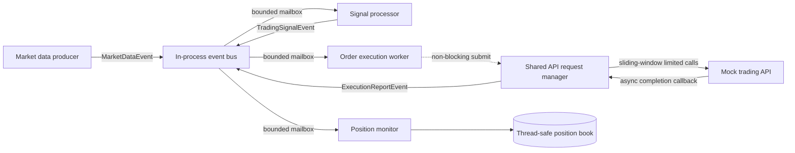

# Event-driven trading system PoC

This project is a small C++20 trading pipeline built to demonstrate real parallel
execution, bounded asynchronous messaging, and one shared rate-limited API request
path. It uses only the C++ standard library and CMake. All prices, orders, failures,
and fills are simulated.

## Architectural decisions

### Language and concurrency model

C++20 is the better fit for this PoC. CPython threads would make blocking network
work concurrent, but the Global Interpreter Lock would prevent ordinary Python
event handlers from executing Python bytecode in parallel. Multiprocessing avoids
that limitation at the cost of serialization and inter-process communication on
every event. C++ threads provide parallel handlers, deterministic RAII-based
lifetime management, direct access to profiling and sanitizers, and a path to lower
allocation and synchronization overhead if measurements justify it. The trade-off
is more explicit lifetime and synchronization code.

The application has one thread for each stateful event-processing responsibility:
the market-data producer, signal processor, order execution worker, and position
monitor. A configurable, small I/O pool belongs to the request manager. The worker
count follows responsibilities rather than available CPU count; adding threads to
a single ordered strategy would require partitioning its state, for example by
symbol.

### Messaging

`EventBus` is an in-process publish/subscribe bus. Each worker owns a bounded
mailbox and condition variable. Publishing creates one immutable event shared by
all matching subscribers, takes a short snapshot of the subscription list, and
attempts one non-blocking enqueue per mailbox. A slow subscriber therefore neither
blocks another subscriber nor creates an unlimited backlog.

Delivery is an at-most-once in-memory offer to every subscriber present in the
subscription snapshot. A successful enqueue is delivered once. A full or closed
mailbox rejects the newest event and increments explicit counters returned to the
publisher and exposed by the bus. Successful events from one sequential publisher
retain enqueue order. Concurrent publishers are ordered by whichever enqueue
acquires a mailbox first; the bus sequence is an identifier, not a cross-thread
ordering guarantee. There is no persistence or recovery after process failure.

Those semantics are deliberate for this latency-oriented demonstration. A live
system must assign policies by event class: coalescing old market quotes can be
reasonable, while orders and executions normally require a durable path or a
fail-closed response when capacity is exhausted.

### Shared API manager

Every worker receives the same `IRequestManager` reference from `main`. Submission
only adds a request to the manager's bounded queue. API I/O threads wait on one
thread-safe sliding-window limiter and call the reusable `IApiClient`; event workers
never wait for rate capacity or network latency.

The sliding window provides an exact allowance rather than the short bursts a token
bucket permits. Its mutex is an intentional serialization point because one API
token has one shared limit. Waiting uses condition variables, without polling.
HTTP 429 responses extend a shared pause and respect `Retry-After`. Timeouts and
transient connection/server failures use bounded exponential backoff. A request is
retried only when it is explicitly idempotent and carries an idempotency key. A
`RequestHandle` supports cancellation, and shutdown can drain accepted work or
cancel it.

Workers receive the event bus, request-manager interface, state store, and their
configuration in constructors. They do not create infrastructure or use global
mutable state. `main` is the composition root and shuts the pipeline down from
upstream to downstream so every stage drains before its consumer closes.

### Architecture



Event publication and bounded enqueue are synchronous and short. Mailbox handling,
API scheduling, and API completion are asynchronous relative to the publisher.
Handlers on distinct worker threads and API calls on distinct I/O threads can run
in parallel.

Likely bottlenecks are the single-threaded handler assigned to each responsibility,
the mutex in each hot mailbox, event allocation and shared-pointer reference counts,
and the inherently shared rate limiter. External API latency and rate limits will
usually dominate the order path. The included benchmark establishes when a more
specialized queue, object pool, symbol partitioning scheme, or batched publication
is warranted; none is assumed to be beneficial without measurement.

## Project layout

```text
app/main.cpp                 Composition, lifecycle, and demo output
include/trading/events.hpp   Immutable event definitions
include/trading/messaging.hpp
src/messaging.cpp            Event bus and bounded mailboxes
include/trading/api.hpp
src/api.cpp                  Shared limiter, retries, cancellation, mock API
include/trading/workers.hpp
src/workers.cpp              Producer and business workers
include/trading/config.hpp
src/config.cpp               Command-line configuration
tests/tests.cpp              Focused concurrency and lifecycle tests
bench/benchmark.cpp          Messaging and API-path measurements
```

## Build and run

A C++20 compiler, CMake 3.20 or newer, and a platform threading library are the only
requirements.

```sh
cmake -S . -B build -DCMAKE_BUILD_TYPE=Release
cmake --build build --parallel
./build/trading_demo
```

The demo defaults to 500 generated quotes and then exits after draining all accepted
work. Useful overrides include:

```sh
./build/trading_demo \
  --events 1000 \
  --interval-us 250 \
  --rate-limit 20 \
  --rate-window-ms 1000 \
  --api-threads 4 \
  --api-latency-ms 5

./build/trading_demo --help
```

No credential is accepted or logged. The order ID is also the mock API's idempotency
key.

## Tests and performance baseline

```sh
ctest --test-dir build --output-on-failure
./build/trading_tests
./build/trading_benchmark                 # defaults: 200000 events, 4 publishers, 200 requests
./build/trading_benchmark 1000000 8 500   # event count, publisher count, request count
```

The tests cover fan-out and type filtering, concurrent publishers, bounded overload,
one rate limit across concurrent submitters, isolation from a slow API, position
state synchronization, idempotency-gated retry, cancellation, and deadlock-free
shutdown.

The benchmark reports internal publish-to-handler p50/p95/p99 latency and throughput
separately from mock API queue, limiter, service, and end-to-end latency. It uses a
monotonic clock. The recorder retains samples to calculate exact percentiles, which
is appropriate for a local baseline but should become a bounded histogram in a
long-running process.

ThreadSanitizer can be enabled where the compiler and runtime support it:

```sh
cmake -S . -B build-tsan -DCMAKE_BUILD_TYPE=Debug -DTRADING_ENABLE_TSAN=ON
cmake --build build-tsan --parallel
ctest --test-dir build-tsan --output-on-failure
```

Results depend heavily on hardware, OS scheduling, compiler, load, and build type.
This project does not claim ultra-low-latency or high-frequency suitability.

## Extension path

- A WebSocket adapter can parse live quotes and publish `MarketDataEvent` objects;
  reconnect and snapshot synchronization remain at that adapter boundary.
- A production HTTP client can implement `IApiClient` with connection pooling,
  TLS, broker authentication, transport cancellation, and response parsing. Worker
  business logic remains unchanged.
- Multiple strategies can own independent subscribed workers. CPU-heavy strategies
  can be partitioned by symbol while preserving per-symbol ordering.
- Each API token can own an `ApiRequestManager` with an independent limiter. A token
  router can inject or select the appropriate manager without putting credentials in
  events.
- New event types and workers require an event definition, a subscribed mailbox,
  and a handler; the bus itself does not change.
- If one process is no longer sufficient, an adapter can bridge selected event types
  to a durable broker. Process boundaries require explicit schemas, correlation and
  idempotency identifiers, replay policy, and stronger delivery semantics; the
  current in-process mailboxes should not be presented as distributed messaging.

