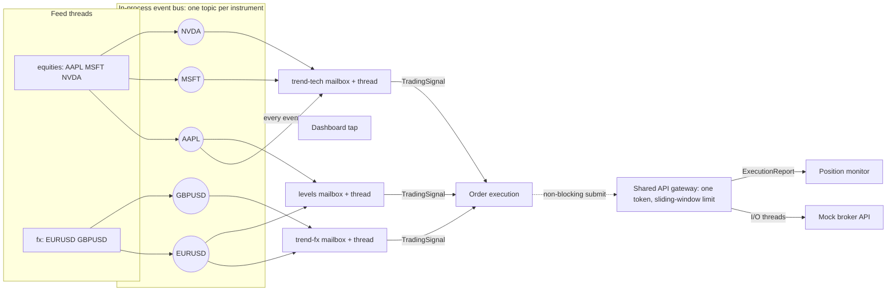

# Event-driven trading system PoC

A small C++20 trading pipeline that demonstrates genuinely parallel event processing,
bounded asynchronous messaging, topic-partitioned market data for multiple independent
strategies, and one shared rate-limited API gateway, with a live browser dashboard. It
uses only the C++ standard library, POSIX sockets for the dashboard, and CMake. All
prices, orders, failures and fills are simulated.

```sh
cmake -S . -B build && cmake --build build --parallel
./build/trading_demo --dashboard          # then open http://127.0.0.1:8080
```

## What the system does



- **Feeds** are threads that publish one quote per instrument per round, each instrument
  on its own **topic**.
- **Strategies** are independent signal processors. Each owns a thread, a bounded
  mailbox, and a strategy object (`threshold` or `ema-cross`), and subscribes only to the
  topics it trades. Subscriptions may overlap: `levels` shares AAPL with `trend-tech` and
  EURUSD with `trend-fx`, and each still gets its own copy of every quote.
- **Order execution** turns signals from every strategy into orders on the **shared API
  gateway**. All requests share one token, so they all pass one limiter.
- **Position monitor** applies execution reports per strategy and symbol.
- **Dashboard tap** is an ordinary subscriber to every event type. It shows that adding
  an observer needs no change to any other component.

The default topology is defined in `SystemConfig::demo()`. It can be replaced from the
command line (see [Configuration](#configuration)).

## Live dashboard

`./build/trading_demo --dashboard` serves a single page at `http://127.0.0.1:8080`
(`--port` changes it). The page streams a JSON snapshot every 200 ms over Server-Sent
Events and shows:

- **Pipeline diagram.** It is built from the bus's live subscription table. Moving dots
  show quote traffic per topic, and individual signals and fills travel as dots in their
  strategy's colour. Every mailbox shows its depth, turning amber when filling and red
  when shedding. Workers also show utilisation.
- **Price small multiples.** The last 20 s per instrument, with ▲/▼ markers for the
  signals each strategy published.
- **Shared API gateway.** Sliding-window usage, waiting and in-flight requests, retries,
  HTTP 429 pauses, and a queue-depth chart.
- **Latency by stage.** p50, p99 and max for the last interval plus the cumulative p99,
  with trends. Stages run from bus to handler per worker, through gateway queueing,
  rate-limit wait and broker round trip, to market data → position.
- **Tape and positions.** P&L is marked to the last price.

The controls act on the running process. You can:
- change the feed rate or pause a feed;
- add simulated per-event work to one strategy;
- raise the broker's latency;
- inject HTTP 429 responses.

Slowing one strategy to 2 ms per event is the clearest demonstration of the design. Its
mailbox fills and sheds stale quotes (about 1.4k/s here), and its dispatch latency grows
to about 570 ms. The two strategies reading the same topics stay at an empty mailbox
with a dispatch p99 of about 20 µs.

The server binds to loopback only. It rejects requests whose `Host` or `Origin` is not
loopback, as protection against DNS rebinding and cross-site use of the controls. It
never sees credentials. Every table has a table-view twin, and colours follow a
palette validated for colour-vision deficiency in light and dark themes.

## Architectural decisions

### Language and concurrency model

C++20. CPython threads would overlap blocking I/O, but the GIL prevents Python handlers
from running in parallel, and multiprocessing adds serialisation on every event. C++
threads give real parallelism, RAII lifetimes, ThreadSanitizer, and control over
allocation and synchronisation.

Threads follow responsibilities, not core count:
- one per feed;
- one per strategy;
- one each for execution, the position monitor and the dashboard tap;
- a small I/O pool in the gateway;
- one dashboard server thread.

State used by a handler is owned by that handler's thread, so strategy state needs no
locks. Scaling one hot strategy beyond one core would mean partitioning its symbols
across processors, which the topic routing already supports.

**Synchronous, asynchronous and parallel work:**
- Publishing is synchronous: the publisher enqueues into each subscriber's mailbox and
  never waits for processing.
- Handling is asynchronous to the publisher.
- Different workers' handlers, and the gateway's I/O threads, run in parallel.
- API calls are asynchronous to the submitting worker, which gets its completion as a
  callback on an I/O thread.

### Messaging

`EventBus` routes by **(event type, topic)**. A subscriber takes either one topic or
every topic of a type. Topics are interned integers, so the publish path never hashes a
string.

Each route's subscriber list is precomputed, so a publish makes one hash lookup and then
one non-blocking `try_enqueue` per subscriber. Events are immutable, allocated once, and
shared, so fan-out copies a pointer, not the event. The route table is read under a
shared lock for the whole delivery. That makes `unsubscribe()` a barrier: once it
returns, nothing is still delivering to that sink.

Each mailbox is a fixed-capacity ring buffer (no allocation per event) with an
**overflow policy**:

| Mailbox | Policy when full | Why |
|---|---|---|
| strategies (market data) | `drop_oldest` | a lagging strategy should act on the freshest quotes |
| execution, position monitor | `reject_newest` | a lost signal or report must be visible to its publisher |
| dashboard tap | `drop_oldest` | an observer must never slow the pipeline |

Neither policy blocks a publisher, so a slow consumer never slows another consumer or
the feed. Evictions and rejections are counted per mailbox.

Workers drain up to 64 events per lock acquisition. Publishers only signal a consumer
that is actually parked.

**Delivery guarantees:**
- At most once, in memory, to every subscriber registered when the event is published.
- Events from one publisher on one topic keep their order in each mailbox.
- Nothing survives a crash.

### Shared API gateway

Every worker receives the same `IRequestManager&` from the composition root. `submit()`
only enqueues into a bounded queue and returns a cancellable handle. I/O threads then:
- wait on one exact **sliding-window limiter**, which never allows a burst above N per
  window;
- honour HTTP 429 `Retry-After` for all threads at once;
- apply bounded exponential backoff;
- retry only idempotent requests that carry an idempotency key.

Order IDs are qualified by strategy (`trend-fx-18`), because they double as idempotency
keys.

**Shutdown policy.** Feeds stop first. Every stage then drains into a consumer that is
still running. API requests still unfinished after `--drain-timeout-ms` (default 5 s)
are cancelled.

### Dependency injection and composition

`TradingSystem` is the composition root. It builds the bus, gateway, mock API, workers
and feeds once, injects them, and owns lifecycle order: consumers start before
producers, and shutdown runs upstream to downstream.

Strategies are plain objects behind `ISignalStrategy`, with no threads or messaging, so
they are unit-tested directly. `SignalProcessor` supplies the thread, mailbox and
publishing. The dashboard server knows nothing about trading. It serves whatever the
injected snapshot provider returns and forwards controls to an injected handler.

## Review findings fixed in this revision

1. **Idempotency-key collision between strategies.** Order IDs were `order-<n>` from a
   per-processor counter. With more than one signal processor, a second strategy's
   first order reused `order-1`, and the broker's deduplication would have returned the
   first order's fill for it. IDs are now strategy-qualified, with a regression test.
2. **Latency recording grew without bound and locked on the hot path.** Every event
   pushed onto a mutex-protected vector. `stats()` copied and sorted every sample while
   holding that mutex, so a live dashboard would stall workers. It is replaced by a
   fixed 8 KiB log-linear histogram with wait-free recording and values within about
   3%. Snapshots subtract, which gives live per-interval percentiles.
3. **Publish-path overhead.** Every publish allocated a subscriber vector and locked
   one `weak_ptr` per subscriber. It also bumped five bus-global atomics that every
   publisher contends on, and mailboxes grew a `std::deque`. The ring buffers,
   precomputed routes, batch draining and parked-only notification measured
   **+33–43% throughput** ([below](#measured-results)).
4. **Routing by type only.** Every subscriber received every instrument. Topics give
   each strategy its own market-data stream.
5. **Unstored subscriptions unsubscribed immediately.** `subscribe()` is now
   `[[nodiscard]]`.
6. **Delivery after unsubscribe.** A publisher's snapshot could still deliver to a sink
   after `unsubscribe()` returned. The shared lock now makes unsubscribe a barrier.
7. **Unbounded drain.** Drain shutdown could wait forever behind the rate limit. It now
   has a timeout, after which remaining requests are cancelled.
8. **Concurrent `shutdown()` calls raced on the I/O thread vector.** They are now
   serialised.
9. **The mock broker's idempotency map grew forever.** It is now a bounded window.
10. **Producer drift.** The producer slept a relative interval after each publish, so
    its rate drifted with publish cost. It now uses an absolute schedule. Pause and
    resume use a condition variable (no polling), and the rate can change at runtime.
11. **Clumsy event definitions.** Events had a virtual base class and positional
    constructors of up to 13 arguments. They are now plain aggregates built with
    designated initialisers, and handlers read them through borrowed pointers without
    touching reference counts.
12. **Smaller fixes:**
    - Worker utilisation is tracked.
    - The exit code no longer treats designed market-data shedding as failure.
    - CMake defaults to a Release build.

## Configuration

```sh
./build/trading_demo --help

# Custom topology: two feeds, three strategies (KIND is threshold or ema-cross)
./build/trading_demo --dashboard \
  --feed us:SPY@560,QQQ@480 --feed crypto:BTC@64000 \
  --strategy spy-levels:threshold:SPY:100 \
  --strategy momentum:ema-cross:SPY,QQQ,BTC:1 \
  --strategy 'everything:threshold:*'   # quote * so the shell does not expand it
```

Other options set:
- the feed rate (`--interval-us`);
- quotes per instrument (`--events`, where 0 means until stopped);
- run duration (`--duration-s`);
- mailbox capacity;
- the rate limit and window;
- API threads and queue capacity;
- mock latency, 429 and failure injection;
- retries and the drain timeout.

Without `--dashboard` the demo publishes 3,000 quotes per instrument, drains, prints a
summary and exits. It exits non-zero if an order, signal or report was lost or any
component failed.

## Build, test, benchmark

Requirements: a C++20 compiler, CMake 3.20+, and POSIX for the dashboard (the core
library is portable; without POSIX the demo builds without `--dashboard`).

```sh
cmake -S . -B build
cmake --build build --parallel
ctest --test-dir build --output-on-failure   # unit/integration tests + a demo smoke run
./build/trading_benchmark                    # [events] [publishers] [api-requests]

cmake -S . -B build-tsan -DCMAKE_BUILD_TYPE=Debug -DTRADING_ENABLE_TSAN=ON
cmake --build build-tsan --parallel && ./build-tsan/trading_tests
```

The 26 tests cover:
- **Messaging:** fan-out and type filtering, topic routing, unsubscribe, concurrent
  publishers with per-publisher ordering, both overflow policies, batching and close.
- **Metrics:** histogram precision and interval deltas.
- **Strategies:** both strategies' signal logic.
- **Isolation:** a slow strategy does not delay others on the same topic.
- **Orders and positions:** unique order IDs across strategies, thread-safe positions.
- **API gateway:** shared rate limiting across submitters, a slow API not blocking
  market data, idempotency-gated retries, `Retry-After` and timeouts, cancellation,
  drain timeout, concurrent shutdown, the mock's bounded deduplication window.
- **Producer:** topics and sequencing, pause and resume.
- **Telemetry:** JSON escaping and well-formedness.
- **End to end:** a full system run where every count has to reconcile, plus
  configuration validation.
- **Dashboard server:** page, SSE stream, controls, and the loopback checks, over real
  sockets.

## Measured results

These are measured on an Apple M3 Max (10 performance and 4 efficiency cores), macOS
26, Apple clang 21, Release build. Results vary with hardware, OS scheduling and load.
Percentiles come from the histogram and are within about 3%.

Tests: 26/26 pass. Under ThreadSanitizer, 26/26 pass with 0 reports on each of 5 runs.
The full demo under ThreadSanitizer, with the dashboard streaming and every control
exercised, also reported 0. The suite passed 30 of 30 runs with three copies running in
parallel for CPU contention.

**Before and after, same workload** (400k events, saturated, median of 5, deliveries/s):

| Publishers → subscribers | Original | This revision | Change |
|---|---|---|---|
| 1 → 1 | 4.38 M | 5.84 M | +33% |
| 4 → 1 | 3.37 M | 4.62 M | +37% |
| 1 → 4 | 2.79 M | 3.81 M | +37% |
| 4 → 4 | 2.67 M | 3.81 M | +43% |

**`trading_benchmark`** (two runs):

- **Publish → handler latency at a sustainable 20k events/s** (includes waking the
  parked consumer): p50 1.8–2.0 µs, p99 4.6–7.2 µs, max 19–24 µs.
- **Four saturated publishers into one subscriber:** 4.4–4.6 M events/s. Latency there
  is queueing (p50 about 4.5 µs).
- **One publisher, fan-out:**

  | Subscribers | Deliveries/s |
  |---|---|
  | 1 | 6.1–6.9 M |
  | 2 | 5.4–5.8 M |
  | 4 | 3.3–4.3 M |
  | 8 | 0.51–0.54 M |

- **One publisher, topic-partitioned subscribers:**

  | Subscribers | Deliveries/s |
  |---|---|
  | 2 | 4.2–4.3 M |
  | 4 | 1.8–2.2 M |
  | 8 | 0.54–0.56 M |

- **API gateway, reported separately from messaging.** 200 requests against a mock
  with 1 ms latency and a 50 per 50 ms limit finish at 1.06–1.16 k requests/s, which is
  the initial window of 50 plus the sustained 1,000/s. Mock service p50 is about 1.3 ms.

**Demo** (defaults, finite run):
- Strategy dispatch p50 is 7–13 µs, with p99 of about 100–150 µs from waking idle
  threads.
- Tick-to-signal p50 is 11–14 µs.
- Market data → position update is about 6.4 ms, dominated by the 5 ms mock broker.
- Under backlog, gateway queueing dominates everything else, which is the shared rate
  limit doing its job.

**The main bottleneck found: wake-ups, not locks.** Throughput falls sharply once one
publisher feeds six or more subscribers, and the original code shows the same cliff
(2.95 M → 0.39 M between 4 and 6 subscribers).

When consumers are faster than the publisher, they park on their condition variables,
so every delivery pays for a wake-up. Here that costs about 2.4 µs per delivery. The
wake-ups slow the publisher, which lets consumers catch up and park again.

More threads therefore do not mean more throughput. Remedies, in order of preference:
- put more symbols on fewer strategy threads;
- publish in batches;
- use a bounded spin-then-park wait in the mailbox, which trades CPU for fewer
  wake-ups.

None of these is applied here. At the demo's 5k events/s wake-ups cost about 1% of one
core, and the right spin budget depends on deployment. These figures establish a
baseline; they do not make this suitable for ultra-low-latency trading.

## Project layout

```text
app/main.cpp                  Entry point: CLI, signals, dashboard wiring, summary
app/dashboard.html            Live dashboard (embedded into the binary at build time)
include/trading/events.hpp    Event aggregates, topics, envelope
include/trading/messaging.hpp src/messaging.cpp   Event bus, ring-buffer mailboxes
include/trading/metrics.hpp   src/metrics.cpp     Fixed-size latency histogram
include/trading/strategies.hpp src/strategies.cpp Threshold and EMA-cross strategies
include/trading/workers.hpp   src/workers.cpp     Feeds, processors, execution, positions, tap
include/trading/api.hpp       src/api.cpp         Shared gateway, limiter, retries, mock broker
include/trading/system.hpp    src/system.cpp      Composition root and lifecycle
include/trading/telemetry.hpp src/telemetry.cpp   JSON snapshot rendering
include/trading/dashboard_server.hpp src/dashboard_server.cpp  HTTP + SSE server (POSIX)
include/trading/config.hpp    src/config.cpp      Command-line configuration
cmake/embed_page.cmake        Embeds the dashboard page
tests/tests.cpp               Tests
bench/benchmark.cpp           Benchmarks
```

## Extension path

- **Live market data.** A WebSocket adapter publishes `MarketDataEvent` on each
  instrument's topic. Reconnects and snapshot recovery stay inside the adapter.
- **A real broker.** Implement `IApiClient` with connection pooling, TLS, auth and
  transport cancellation. Workers do not change.
- **More strategies.** Add a `--strategy` or a new `ISignalStrategy`. A strategy that
  needs more than one core can be split by symbol, each part with its own processor and
  topics, which preserves per-symbol order.
- **Multiple API tokens.** Create one `ApiRequestManager` per token, each with its own
  limiter, and inject the right one, or route by account, without putting credentials
  in events.
- **New event types and workers.** An event is an aggregate with a `kEventName`; a
  worker is an `EventWorker` plus a handler. The bus does not change.
- **Multiple processes.** Bridge selected topics to a durable broker at an adapter.
  That needs schemas, idempotency and replay policy. The in-process bus should not be
  presented as distributed messaging.
